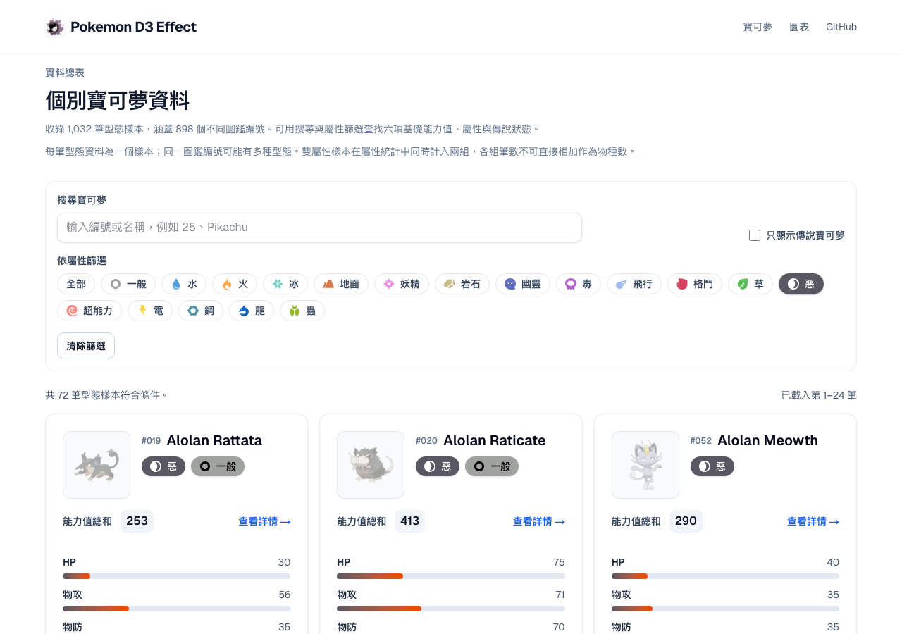

# 圖鑑屬性篩選對比修正

日期：2026-09-27。

## 問題與修正

選取惡、龍等屬性時，篩選按鈕原本固定深色文字；屬性 SVG 也與按鈕底色相同，造成文字低對比及圖示消失。

`PokemonList` 沿用卡片既有的 `typeBadgeForeground`，依屬性底色選擇黑色或白色文字，選取圖示套用相同前景。保留屬性底色、取消選取的原色圖示、網址同步與按鈕操作；沒有修改卡片。

## 驗證

`tests/e2e/catalog-filter-contrast.spec.ts` 在明、暗主題各操作 18 種屬性，逐一選取及取消，檢查：

- `aria-pressed` 與網址條件同步。
- 按鈕及祖先半透明背景合成後，小字對比至少 4.5:1。
- 選取圖示載入成功、可見且使用同一高對比前景。
- 取消後恢復原色圖示，文字不以整體透明度淡化。

每次狀態轉換後等待 Web Animations 回報 CSS transition 完成再量測，避免記錄過渡色。

修正前獨立正式版（`593d6d3`，`http://127.0.0.1:4190`）執行兩個主題案例皆失敗：選取圖示的 computed filter 仍為 `none`。結果位於 `test-results/regression-DVPGTD/catalog.log`。

```bash
PLAYWRIGHT_BASE_URL=http://127.0.0.1:4190 yarn test:e2e --suite=catalog catalog-filter-contrast.spec.ts --project=chromium
yarn test:e2e --suite=catalog catalog-filter-contrast.spec.ts
```

修正後完整三瀏覽器回歸中，此檔 **6／6 案例通過**，涵蓋 216 組屬性／主題／選取狀態／瀏覽器文字對比。證據 `test-results/regression-jsc4q7/catalog.log`。

修正後 Chromium 的明暗 2 案皆通過（`test-results/regression-lxr9bF/catalog.log`），每案涵蓋 18 屬性選取／取消。


