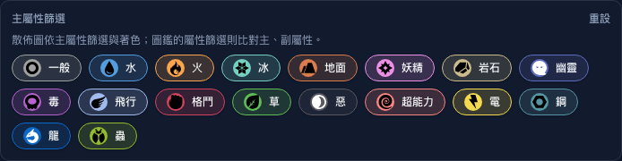

# 散佈圖主屬性圖例對比修正

日期：2026-09-27。

## 問題與修正

圖例原本直接以屬性色當文字色，選取底色亦是同色半透明填色；取消狀態再降低整體 opacity，讓電、冰等屬性在明色及惡、龍等在暗色難以閱讀。

`TypeLegend` 改用主題前景色顯示文字，保留屬性色邊框及選取底色，取消狀態使用透明底與虛線邊框。移除整體 opacity，避免降低文字對比。圖示放在屬性色小圓底，以既有 `typeBadgeForeground` 選擇黑白圖形，讓 18 種圖示在兩種主題仍可辨識；按鈕名稱和 `aria-pressed` 行為不變。

## 驗證

`tests/e2e/chart-legend-contrast.spec.ts` 在明、暗主題各量測 18 種圖例的選取及取消狀態：

- 合成按鈕及祖先半透明背景，文字對比至少 4.5:1，整體 opacity 為 1。
- 圖示確實載入，圖形與小圓底對比至少 4.5:1。
- Space 可取消及重新選取，取消時底色不同，圖示顏色保持一致。

每次狀態轉換後等待 CSS transition 完成再記錄顏色，沒有固定延遲。

修正前獨立正式版（`593d6d3`，`http://127.0.0.1:4190`）兩個主題案例皆失敗：明色首先測得文字 2.17:1，暗色原圖示沒有高對比前景。結果位於 `test-results/regression-DVPGTD/catalog.log`。

```bash
PLAYWRIGHT_BASE_URL=http://127.0.0.1:4190 yarn test:e2e --suite=catalog chart-legend-contrast.spec.ts --project=chromium
yarn test:e2e --suite=catalog chart-legend-contrast.spec.ts
```

最終三瀏覽器定向 **6／6 通過**，共 216 組文字狀態對比及 108 組圖示對比；圖示載入同步與結果詳見下節。

修正後 Chromium 的明暗 2 案皆通過（`test-results/regression-lxr9bF/catalog.log`），每案涵蓋 18 屬性選取／取消。



## Firefox 圖示載入同步

整合回歸首次執行時，Firefox 兩個主題在圖示 `naturalWidth > 0` 斷言失敗。Trace 及獨立操作確認，圖例初始位於 y=2016，視窗高度 720；圖示為 lazy loading、尚未送出請求，滾入視窗後即成功載入（`naturalWidth=512`）。`toBeVisible` 只確認 CSS 可見，不能保證懶載入已觸發。

測試改為先將按鈕捲入視窗，再以 `expect.poll` 等待 `naturalWidth > 0`。保留載入成功的斷言，產品仍維持按需載入；沒有調整對比門檻。

以相同最終正式建置 `http://127.0.0.1:4193` 定向重跑：Chromium、Firefox、WebKit 的明暗主題共 **6 案通過**（1.5 分鐘）。結果：`test-results/regression-miGVlD/catalog.log`。修正後測試通過 ESLint。
