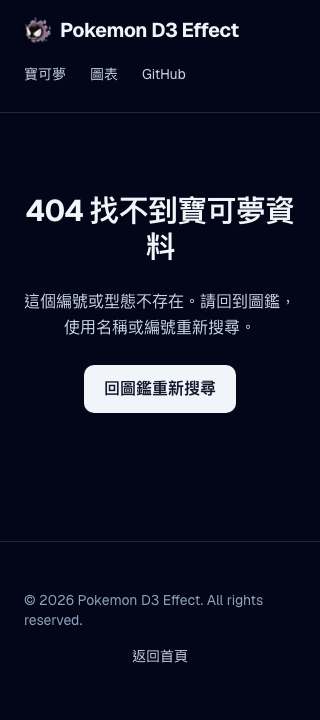

# 圖鑑 404 返回搜尋驗收

日期：2026-09-27。

## 修正

`src/app/pokemon/not-found.tsx` 為圖鑑路由提供繁體中文找不到資料頁面，主標題為「404 找不到寶可夢資料」，說明編號或型態不存在，並在主內容提供「回圖鑑重新搜尋」連結。沿用詳細頁的 `notFound()`，不以轉址或正常資料取代錯誤回應。

返回連結指向 `/pokemon`，可用鍵盤操作，具有至少 44px 高度與明暗主題的焦點提示；搜尋仍使用既有圖鑑入口。

## 定向回歸

`tests/e2e/not-found-recovery.spec.ts` 涵蓋：

- 無效型態、不存在編號、非法編號，均須回傳 HTTP 404 並顯示正確 `h1` 與返回連結。
- 不顯示其他寶可夢的能力值細節。
- 320px 手機寬度下，鍵盤可開啟返回連結並取得可操作的搜尋欄。

重現命令：

```bash
yarn test:e2e --suite=catalog not-found-recovery.spec.ts --project=chromium
```

本次修改檔案的 ESLint 檢查已通過。修正前的獨立正式版服務（HEAD `29c7380`）以此新測試驗證，因缺少繁中標題／返回連結而失敗（`test-results/regression-Vj8K8n/catalog.log`）。修正後的隔離正式建置已成功，Chromium、Firefox、WebKit 共 **12／12 通過**（`test-results/regression-BoZobr/catalog.log`）。

初次沙箱內建置遇到 Google Fonts DNS 限制，初次瀏覽器啟動遇到 macOS MachPort 沙箱限制，均屬測試環境失敗，不列為產品測試結果；後續在允許的執行環境重跑。

修正後 320px 暗色頁面已人工檢查截圖，返回按鈕及說明完整顯示，頁面沒有水平溢出：


