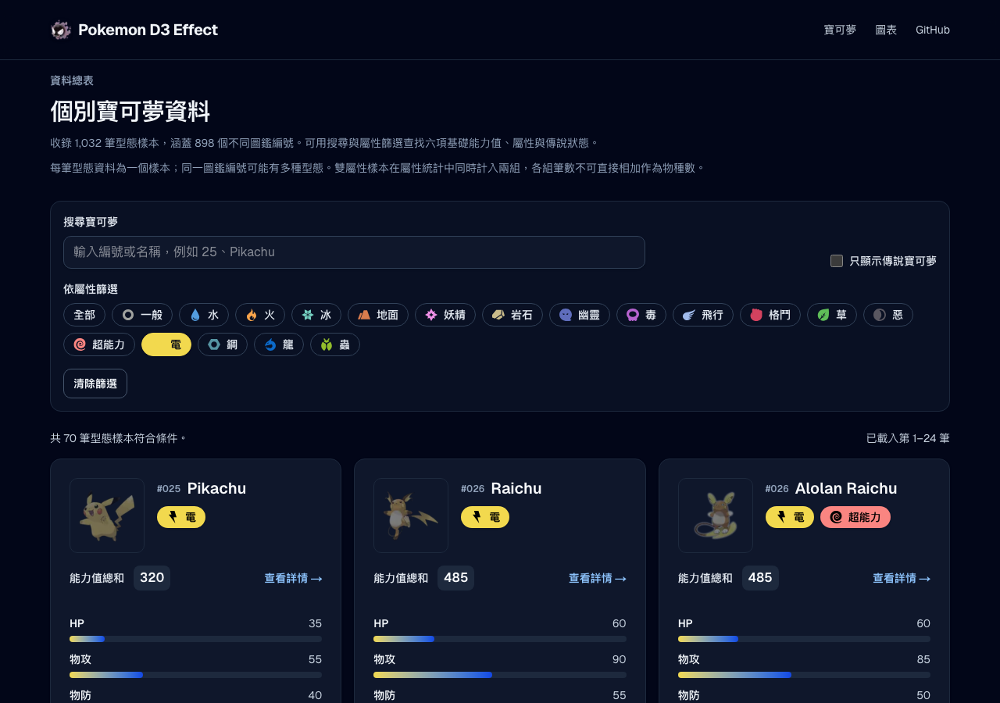

# 圖鑑屬性徽章對比修正

日期：2026-09-27。

## 問題與調整

原版卡片使用固定屬性色背景，暗色主題卻一律使用近白文字；例如電屬性僅約 1.36:1。屬性 SVG 的原始填色與徽章背景相同，圖示也容易融入背景。

- 保留 18 種屬性色背景；依底色的 sRGB 相對亮度，選取黑色或白色中對比較高的文字，主題切換不降低對比。
- 圖示透過 brightness／invert 使用相同前景色，避免與底色重疊；旁有完整屬性名稱，因此圖示的空 alt 避免重複朗讀。
- 調整限於圖鑑卡片，不改相剋、圖表或詳細頁的屬性色呈現。

## 回歸案例

`tests/e2e/type-badge-contrast.spec.ts` 從公開 `/pokemon?type=...` 入口，逐一讀取 18 種屬性在明／暗主題的實際瀏覽器文字與背景色，依 WCAG sRGB 公式要求正常小字至少 4.5:1，同時檢查圖示濾鏡與前景一致。每次測試附上 JSON 色彩與對比測量，共 36 種組合。

原版正式服務（基準 `29c7380`）的兩個 Chromium 案例均由對比斷言重現失敗：明色 4 種、暗色 15 種文字低於 4.5:1，最低為暗色電屬性 **1.355:1**；36 個徽章的圖示均未套用可辨識的前景濾鏡。證據：`test-results/regression-R3leXx/catalog.log`。

修正版依現行 18 色計算的最低文字／單色圖示對比為格鬥屬性 **4.714:1**，最高電屬性 **14.811:1**；這是調色盤靜態計算；正式頁面明／暗 36 組在三種瀏覽器均通過至少 4.5:1 的測量斷言。

定向與全專案 ESLint 通過。修正版 Chromium、Firefox、WebKit 共 **6／6 案例通過**，涵蓋 108 組屬性／主題／瀏覽器測量；證據為 `test-results/regression-BoZobr/catalog.log`，測試報告附每組色彩與對比 JSON。

重現修正版：

```sh
yarn test:e2e --suite=catalog type-badge-contrast.spec.ts
```

runner 使用隔離正式建置，不使用根 `.next` 或開發服務。

修正後暗色電屬性卡片截圖：


